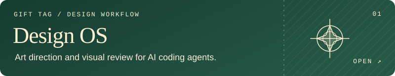

# Juicix

## About

I'm an **Art Director** and **Front-End Developer**. I'm also the **Lead Designer at an aesthetic medicine clinic in Moscow**, where I lead the clinic's visual direction and work on its digital presence.

I work across art direction, web design, and front-end development, taking ideas from the first visual concept to the browser. I care about typography, motion, and how a design feels to use.

## Tech stack

| Area | Tools |
| --- | --- |
| Front-end | React, TypeScript, JavaScript, HTML, CSS |
| Visual development | SVG, CSS animation, Tilda |
| Tooling and automation | Node.js, Python, PowerShell, Git, GitHub Actions |

## Under the tree

[Design OS](https://github.com/juicix/design-os) is a design workflow for AI coding agents, from research and art direction to implementation and visual review.

[Producer Megamozg](https://github.com/juicix/Producer-megamozg) is a Codex and Claude skill for audience research, content strategy, and launch planning.

## GitHub activity

<picture>
  <source media="(prefers-reduced-motion: reduce)" srcset="assets/commit-lights-still.svg">
  
</picture>

The calendar uses GitHub's public commit counts. Each square represents a day, and brighter colors mark more commits. [Read the monthly totals](docs/public-activity.md) or [view my GitHub activity](https://github.com/juicix#js-contribution-activity).

## Holiday terminal

<picture>
  <source media="(prefers-reduced-motion: reduce)" srcset="assets/ascii-tree-still.svg">
  
</picture>

**Happy New Year!** 🎁
